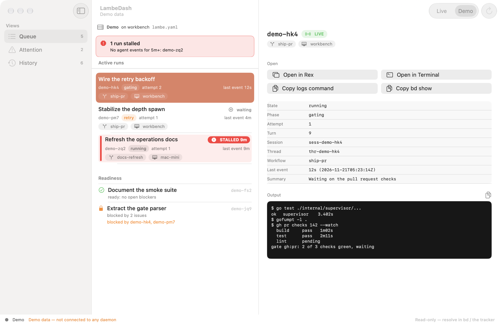

# LambeDash — lambe operator dashboard

Native macOS SwiftUI app for the lambe daemon. It attaches to a running
daemon over the daemon's authenticated local HTTP state API and renders
Queue, Attention, History, run detail, and live output. The app never changes
a run: it polls with GET requests, and needs-human items are resolved in Beads
or the tracker. What it does offer is navigation (below): hand a run to Rex,
or fall back to Terminal, a copied command, or Finder.



The project is a single committed `.xcodeproj` with no third-party
dependencies and no code-generation step.

## Requirements

- Xcode 26 or newer (project built with Xcode 27.2, Swift 6 toolchain).
- Deployment target macOS 26.0.
- Signing is ad-hoc ("Sign to Run Locally"): the app builds and runs without
  a developer certificate.

## Open in Xcode

```
open apps/dashboard/LambeDash.xcodeproj
```

Press Cmd+R to run: the `LambeDash` scheme builds the app and shows its
window. The project uses file-synchronized groups, so files added under
`Sources/` or `Tests/` are picked up without editing the project file.

## First run

With no daemon attached the window shows a setup guide instead of empty
columns. It scans the default state directory and the instances you have
added for running daemons and offers **Connect** for each. If none is
running it walks the four steps with the exact commands to copy:

1. install `lambe` (it checks `PATH`, `~/.local/bin`, `~/go/bin`, Homebrew),
2. `lambe init` to write the config,
3. turn on the state API (`stateapi:` / `enable: true`, or
   `LAMBE_STATEAPI_ENABLE=true` for one run),
4. `lambe run`.

**Start in Terminal** opens Terminal running the command shown (the app
starts nothing itself), **Choose Folder…** adds another state directory, and
**Explore Demo Data** opens sample data. The guide rechecks every two seconds
and steps aside when a daemon attaches. Reopen it any time from
**Dashboard → Setup Guide…** (⇧⌘G) or Settings → General.

## Menus, shortcuts, and preferences

| Shortcut | Action |
| --- | --- |
| ⌘1 / ⌘2 / ⌘3 | Show Queue / Attention / History |
| ⌘R | Refresh state |
| ⇧⌘D | Switch between demo data and the daemon |
| ⇧⌘G | Setup guide |
| ⌥⌘R | Open the selected run in Rex |
| ⌥⌘T | Open the selected run in Terminal |
| ⌥⌘C / ⌥⌘B | Copy the logs command / `bd show` |
| ⌥⌘F | Reveal the run's workspace in Finder |
| ⌥⎋ | Clear the selection |

Right-click a run for the same actions. Settings (⌘,) has **General** (where
Open prefers to send runs, start with demo data), **Instances**, and **Tools**
(where `lambe` and `rex` were found, with a path override for each).

Selection is dropped whenever the connection context changes (another
instance, demo/live switch, or a daemon with a different config or machine),
so one daemon's issue IDs never linger over another daemon's data.

## Demo mode

Launch with `--demo` (or turn on Settings → General → Start with demo
data) to open straight into it. The window toolbar has a segmented Live/Demo
picker. Choose **Demo** to
browse all four views with bundled sample data — no daemon, tracker, or
state API needed. The **Dashboard** menu offers the same switch ("Show Demo
Data" / "Connect to Daemon"), and the window subtitle reads "Demo data"
while sample data is up. Switch back to **Live** to attach to a daemon
(below).

## CLI build and test

mise wraps both commands with a repo-local derived-data path:

```
mise dashboard:build
mise dashboard:test
```

Directly:

```
xcodebuild -project apps/dashboard/LambeDash.xcodeproj \
  -scheme LambeDash -destination 'platform=macOS' build

xcodebuild -project apps/dashboard/LambeDash.xcodeproj \
  -scheme LambeDash -destination 'platform=macOS' test
```

`DerivedData/` and `.build/` under `apps/dashboard/` are git-ignored; keep
build artifacts out of tracked source.

## Stalled runs

Silent stalling is the failure the app is built to surface. A running run
whose last event is older than 2 minutes reads **quiet**; older than 5
minutes it is **STALLED**: a red row with a "STALLED 9m" badge, a red banner
above the queue naming every stalled run, a "N STALLED" window subtitle, and
a red count on the instance in the sidebar. Deferred runs are never flagged
(silence is expected while they back off), and a run with no observed event
time reads "no events yet" rather than stalled. The thresholds live in
`Sources/Models/StallPolicy.swift`; the daemon reports only the event time.

## Run actions: Rex first, fallbacks always

The run detail column opens with a LIVE / QUEUED / ARCHIVED badge, then an
**Open** row. Only buttons that can work are shown:

- **Open in Rex** (only when the `rex` CLI is found on `PATH`, `~/.local/bin`,
  `/opt/homebrew/bin`, or `/usr/local/bin`, or at the Settings override):
  focuses the Rex window labelled `Lambe · <issue>` if it exists
  (`rex window focus`), otherwise opens one running
  `lambe logs -issue <issue> -follow` (`rex window new`). The label matches
  the `lambe_open_run` action in `contrib/rex/lambe.lua`, so both paths share
  one window per run. A run whose `machine` is not this Mac's daemon is opened
  on that machine with `rex -S <machine> …` (the machine name must be a Rex
  host label; see `rex hosts`), and the Terminal and Finder actions are not
  offered for it because they would act on the wrong computer. Without Rex
  the app says so and falls back; a failing Rex reports why.
- **Open in Terminal**: runs the same logs command in Terminal.app.
- **Copy logs command** / **Copy bd show**: the exact command, config pinned
  with `-config` to the daemon the app is attached to.
- **Reveal workspace**: the run's working directory in Finder, only when it
  exists on this Mac.

There is no retry, cancel, or nudge: the daemon's state API is read-only and
its control surface (`internal/daemon/control.go`) is MCP-only.

## Instances and machines

The sidebar lists every configured instance (one per machine or workflow
config) with its own status dot. The selected one shows its live connection
state and stalled count; the others show what their live descriptor says
(daemon up with pid and version, offline, or ambiguous), read from disk, not
the network. Click an instance to switch to it. The content column's header
names the attached instance, machine, and config file.

## Launch flags

For demos, screenshots, and isolated runs (never needed in normal use):

| Flag | Effect |
| --- | --- |
| `--demo` | start with the sample data |
| `-LambeScenario <name>` | render a network-free fixture scenario |
| `-LambeSection queue\|attention\|history`, `-LambeIssue <id>` | initial view |
| `-LambeStateDir <path>` | default state directory (instead of `LAMBE_STATE_DIR` / `~/.local/state/lambe`) |
| `-LambeDefaultsSuite <name>` | keep preferences and instances in that defaults domain |
| `-LambeWindowSize WxH`, `-LambeAppearance light\|dark` | window size and appearance |
| `-LambeHeadless` | accessory activation policy; the window is sent behind others and never made key, so automation never takes focus |

To try the app without touching a production daemon, point it at an isolated
one: run a throwaway daemon with its own `HOME`, `LAMBE_STATE_DIR`, config
and Beads database, then launch the app with
`-LambeStateDir <that state dir> -LambeDefaultsSuite lambe.scratch`.

## SwiftUI previews and screenshots

`Sources/Views/Previews.swift` has previews for the whole window (live,
stalled, stalled in dark mode, archive, empty, disconnected, never
connected, long text, multiple machines) and for the queue at 320 pt, run
rows by liveness, badges, instance rows, the detail column, and the action
row with and without Rex. All of them use `ConnectionModel.fixture(_:)`
(`Sources/Models/FixtureScenario.swift`): fixtures never poll, never read
descriptors, and never touch the network.

The same scenarios render in the real app:

```
LambeDash.app/Contents/MacOS/LambeDash -LambeScenario stalled -LambeIssue lam-103
```

`apps/dashboard/scripts/screenshots.sh [OUT_DIR] [name=args...]` builds into
a temp DerivedData directory and captures the real window of the demo data
(light and dark by default, 1200x780) with `screencapture -l`. It launches
with `open -g` and `-LambeHeadless`, so it never activates the app or raises a
window while you work, and it quits only the instance it started. It needs
Screen Recording permission for the terminal. The README screenshots are
`docs/assets/dashboard-app-light.png` and `dashboard-app-dark.png`.

## Attaching to a daemon

The dashboard discovers daemons by enumerating the per-instance descriptor
files the daemon publishes under the state directory's `live/` directory.
Descriptors exist only when the daemon opts in: `stateapi.enable` is off by
default, and `stateapi.addr` defaults to an ephemeral loopback address
(`127.0.0.1:0`). When enabled, every route requires the per-start bearer
token carried in those 0600 descriptors; the token never appears in logs.

Instance selection is explicit in Settings, so a dev or smoke instance is
easy to tell apart from a production daemon, and the window subtitle names
the daemon — identity and version — it is attached to. Attaching is
read-only: the app never starts, stops, or restarts a daemon. Production
lifecycle stays with the terminal running `lambe run` or the launchd/systemd
units in the reference's
[Keeping the daemon running](../../docs/REFERENCE.md#keeping-the-daemon-running) section.

The wire contract — routes, DTO fields, discovery, and auth posture — is
specified in [docs/api/state-api.md](../../docs/api/state-api.md); the
fixtures the Swift tests decode live in `testdata/contract/v1/`.

## Distribution

Each release attaches `LambeDash.zip` and `LambeDash.zip.sha256` to the
matching `vX.Y.Z` [release](https://github.com/andrew-bierman/lambe/releases).
Live data needs a running Lambe v0.9.0 or later daemon with the local state API
enabled; the setup guide in the app shows how.

`mise dashboard:package` builds the ZIP locally. The script builds the app natively with Xcode
(`-configuration Release`, universal arm64 + x86_64), checks the mascot app
icon is in the compiled catalog, signs it ad hoc with the hardened runtime
(or with Developer ID, below), verifies the signature with `codesign --verify`,
and packs `LambeDash.app` into `apps/dashboard/.build/package/`:

- `LambeDash.zip` — the app, packed with `ditto` so the signature and
  metadata survive.
- `LambeDash.zip.sha256` — checksum of the ZIP; verify a copy with
  `shasum -a 256 -c LambeDash.zip.sha256` from that directory.

The packaging build has its own DerivedData path under
`apps/dashboard/.build/package/` and does not disturb `dashboard:build` or
`dashboard:test`. The same machine and Xcode rebuild the same app; ZIP
timestamps differ per run, so the checksum identifies each build.

### Requirements on the receiving Mac

- macOS 26.0 or newer — the deployment target is macOS 26.0; older systems
  refuse to launch the app.
- No Xcode, command-line tools, or third-party dependencies: the ZIP contains
  one self-contained `.app` bundle.

### Signing, and opening it the first time

The release ZIP is universal (arm64 + x86_64) and **ad-hoc signed** with the
hardened runtime (`codesign -s - --options runtime`). That proves the bundle
was not modified after signing but carries no developer identity, and it is
not notarized, so Gatekeeper blocks a downloaded copy on first launch with
"LambeDash can't be opened". Pick one:

1. **Right-click Open.** Unzip, move `LambeDash.app` to Applications,
   right-click it, choose **Open**, then **Open** again. macOS remembers the
   choice. (On macOS 15 and later the first plain double-click shows a dialog
   with only Done; open **System Settings → Privacy & Security** and press
   **Open Anyway** next to the LambeDash notice, then confirm.)
2. **Remove the quarantine flag** if you downloaded it from this repository's
   releases and have checked the checksum:
   ```sh
   shasum -a 256 -c LambeDash.zip.sha256
   xattr -dr com.apple.quarantine /Applications/LambeDash.app
   ```

An app built on your own Mac is not quarantined and just opens.

### Developer ID and notarization (drop-in)

`scripts/package-dashboard.sh` reads these environment variables when set and
otherwise stays ad hoc:

| Variable | Effect |
| --- | --- |
| `APPLE_SIGNING_IDENTITY` | sign with this Developer ID Application identity (hardened runtime, secure timestamp) instead of ad hoc |
| `APPLE_NOTARY_PROFILE` | notarize with this `notarytool` keychain profile, staple, and re-pack |
| `APPLE_ID`, `APPLE_TEAM_ID`, `APPLE_APP_SPECIFIC_PASSWORD` | notarize with these credentials instead of a profile |

Notarization requires the Developer ID identity. A notarized, stapled build
opens with no Gatekeeper prompt; nothing else in the project changes.

### Connecting to a daemon

The packaged app attaches to daemons exactly like the dev build; nothing is
baked in at package time. The daemon must opt in to the state API first —
`stateapi.enable` is off by default, `stateapi.addr` defaults to loopback
(`127.0.0.1:0`), and every route requires the per-start bearer token published
in the daemon's 0600 descriptor file under the state directory's `live/`.
Pick the instance in Settings; the app is read-only and never starts, stops,
or restarts a daemon — production lifecycle stays with the terminal running
`lambe run` or the launchd/systemd units. Full details: [Attaching to a
daemon](#attaching-to-a-daemon) and
[docs/api/state-api.md](../../docs/api/state-api.md).

## Smoke test

The Go assembled smoke (`test/dashsmoke`, run with
`LAMBE_TEST_BD=1 mise exec go -- go test ./test/dashsmoke`; the test lives
in the sibling `../lambe-shared-client` worktree until it is integrated
here) builds the compiled `lambe` binary,
boots it against a disposable tracker with `stateapi.enable: true`, and
exercises the daemon's Go API client: descriptor discovery, an authenticated
state read, uniform 401s without the token, a 202 refresh, and descriptor
cleanup after a graceful stop. It covers the daemon and its client only.

The app itself is verified manually against an isolated daemon (never a
production one): run it, connect, and compare the views against
`lambe status`.
Demo mode (above) covers the sample-data path.

## Layout

- `Sources/LambeDashApp.swift` — `@main` with `WindowGroup` + `Settings`.
- `Sources/Api/` — contract client: wire DTOs, the `DaemonClient` protocol,
  HTTP transport, descriptor decode.
- `Sources/Models/` — connection and feed models, sample data, the instance
  store, setup/discovery, tool lookup and preferences, and run actions.
- `Sources/Views/` — shell, section and status views, run detail with live
  output, the setup guide, menu commands, and Settings (General, Instances,
  Tools).
- `Tests/ApiTests/` — Swift Testing decode, store, and transport tests over
  the committed contract fixtures.
- `Tests/ModelsTests/` — Swift Testing model state tests.
- `Tests/ModelsTests/RunActionTests.swift` — stall policy, run actions,
  standing, and fixture scenarios.
- `Tests/AppSmokeTests.swift` — Swift Testing smoke suite proving the test
  harness runs; hosted in the app process.

## Tests

The suite is Swift Testing unit tests: decode, store, and transport tests
over the committed fixtures, plus model state tests. The UI is verified by
running the app (Cmd+R); see Smoke test above for the daemon side.
