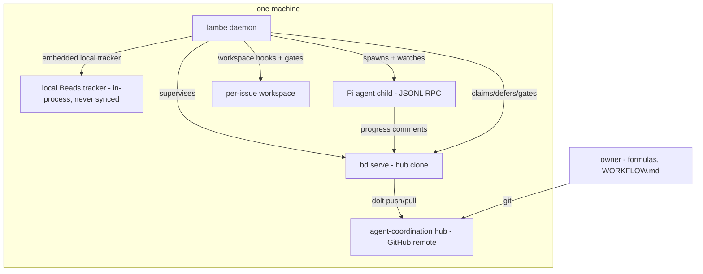
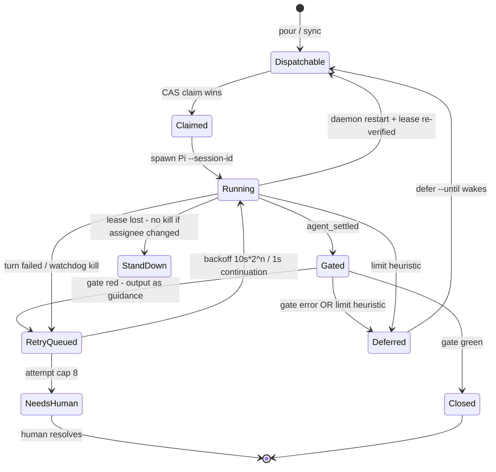

# lambe slice one — Symphony-compatible supervisor - Plan

## Goal Capsule

- **Objective:** One machine runs autonomous coding agents unattended through crashes, hung turns, limit lockouts, and false completion claims — and a person returning later finds only externally-verified completed work or explicitly flagged needs-human items, with all state visible through Beads.
- **Means:** A Go supervisor daemon implementing the OpenAI Symphony specification §18.1 (pinned `8001b52`) with Beads as its entire state substrate and the Pi agent as first harness driver; verified completion via gates; a fault-injection suite as the definition of done (KTD3, KTD2, KTD7).
- **Authority hierarchy:** Symphony SPEC @ `8001b52` > bd 1.4.0 official docs > this plan's KTDs > unit approaches. Conflicts resolve downward from the spec.
- **Execution profile:** One PR. Greenfield repo, Go 1.26 floor, single binary, one machine.
- **Stop conditions:** Stop and report if implementing §18.1 against bd 1.4.0 proves infeasible (spec-invalidated), or if a session-settled decision is invalidated by implementation evidence. Otherwise stop when the Definition of Done holds.
- **Who finishes:** `ce-work` implements; the owner reviews and ships.

---

## Product Contract

### Summary

lambe slice one builds the supervisor daemon: a Symphony-conformant core loop dispatching hub work to a Pi agent in a sanitized workspace, gated completion where done means external checks green, crash-only durability, and the five-scenario fault-injection suite that proves it. Everything ships behind swappable adapter interfaces with Beads and Pi as the first-party defaults.

### Problem Frame

Autonomous coding agents stop making progress unattended. The verified 2026 record across OpenClaw and Hermes counts 13+ incidents of silent supervisor death while health checks stayed green; Symphony's reference implementation holds scheduler state in memory by spec; symphony-beads resets attempt counters on restart. Nothing on any machine of the owner's owns the missing layer: durable desired state plus a watchdog that launches, monitors, replaces, and resumes agent sessions. The owner runs Beads on Dolt as a live cross-machine coordination hub and lives in Rex; the supervisor must ride that fabric, not replace it.

### Requirements

**Conformance and loop**

- R1. The daemon implements the Symphony §18.1 REQUIRED-for-conformance surface at SPEC commit `8001b52`: WORKFLOW.md loader with hot-reload that never crashes on invalid reload, typed config layer with defaults and `$VAR` resolution, polling orchestrator, tracker adapter with state-list and ID-refresh reads, sanitized per-issue workspaces with the four lifecycle hooks, strict `{issue, attempt}` prompt rendering, exponential retry with continuation retries, reconciliation stopping runs on terminal states, terminal workspace cleanup, and structured logs carrying `issue_id`/`issue_identifier`/`session_id`. The agent-invocation target is a documented divergence: the Pi driver honors the launch/turn contract in place of the Codex app-server client (permitted by SP958-962 when the contract is honored).
- R2. The Beads tracker adapter publishes a Symphony adapter profile and implements the two-read contract (state-list, ID-refresh), including the empty-input short-circuit.

**State substrate**

- R3. All shared work state — tasks, claims, dependencies, progress comments, memories — lives in Beads; the daemon creates no second shared store. The tracker adapter is layout-agnostic: a shared multi-project hub, repo-level trackers, or `.beads/` committed inside repos are all supported, selected by config — never assume one board topology.
- R4. The daemon's operational state (harness session bindings, attempt counters, wake timers, process-group bindings) lives in a machine-local embedded-Beads tracker that never syncs; wake timers use native defer semantics.
- R5. Responsibilities are declared as Beads formulas (TOML under `.beads/formulas/` in the hub repo), materialized through cook/pour, and dispatched through the same loop as finite work.

**Reliability**

- R6. The daemon is crash-only: safe to SIGKILL at any instruction; every reconcile decision derives from Beads state and the local tracker, never from memory alone.
- R7. Supervised runs are watched by a silence-timeout watchdog with two independent liveness signals, and every kill path uses the group SIGTERM → bounded grace → group SIGKILL ladder.
- R8. Provider limit lockouts are classified heuristically (Pi emits no limit signal) and handled by deferring the issue with a wake-at-reset time rather than burning retry attempts.
- R9. A responsibility stops dispatching after 8 failed attempts (configurable), or after a configurable run of consecutive gate-infra errors or heuristic deferrals with no completed attempt, moving its issue to a needs-human status with the last gate output written to Beads; the workspace is retained for inspection.

**Verified completion**

- R10. No path to done exists except a green gate: agent self-declaration, exit codes, and `agent_settled` alone are never terminal. Gate outcomes are three-valued — green closes, red retries with the gate output as continuation guidance, error defers and retries the gate without consuming the attempt budget.
- R11. Each attempt is judged by the formula and WORKFLOW revision pinned at claim time; a new revision applies from the next claim.
- R12. Gate rejections are written back to Beads so the next attempt's reconstructed context explains why the previous one was rejected.

**Parity and configurability**

- R13. Every piece of state a supervised agent needs to act (attempt number, claim state, progress history, gate results, deferral reason) is readable through `bd` or delivered in the rendered prompt; the daemon keeps no agent-relevant channel agents cannot read.
- R14. Tracker, harness, store, gate-check, and surface boundaries are Go interfaces with Beads/Pi as first-party implementations, so each layer is swappable by an adapter.
- R15. The daemon runs zero-config on one machine against an existing hub clone; every knob has a documented default overridable by file/env/flag.

**Proof**

- R16. The fault-injection suite passes: daemon kill -9 mid-reconcile (zero responsibility loss), agent SIGKILL mid-turn (resume same session, no duplicate side effects), simulated limit lockout (defer then wake), fake done with failing tests (gate rejects, retry carries rejection), duplicate tick (no double dispatch).

### Key Decisions

- **Name is lambe.** Collision-checked 2026-11-15: npm, crates, PyPI, Homebrew free. Governs the binary, module path, and repo identity.
- **lambe implements the OpenAI Symphony specification** (Apache-2.0, `8001b52`), positioned as a durable superset with a documented multi-orchestrator divergence. (session-settled: user-directed — chosen over a bespoke-only contract: spec alignment is real discoverability; durability is a permitted superset.) Governs R1, R2.
- **Beads is the entire state substrate** — hub for shared work, local embedded tracker for machine-private operational state, formulas for responsibilities. (session-settled: user-directed — chosen over a SQLite local store and a self-owned state plane: removes a store; embedded mode verified serverless.) Governs R3, R4, R5.
- **Open source, config-driven with batteries-included defaults.** (session-settled: user-directed — chosen over a personal-only tool: the owner's use is the example, not the limit.) Governs R13, R14, R15.
- **Every layer swappable by adapter.** (session-settled: user-directed — chosen over a hardcoded stack: adopters keep Beads or Pi only if they want to.) Governs R14.

### Success Criteria

- The five fault scenarios of R16 pass deterministically in CI, including under `-race`.
- An example keep-tests-green responsibility runs end-to-end unattended against a scratch repo: red CI detected → work poured → agent dispatched → gate green → closed, with the full record readable via `bd`.
- The §18.1 conformance checklist (Verification Contract) is satisfied item by item.

### Actors

- A1. **Owner** — authors formulas and WORKFLOW.md in the hub repo, reads state via `bd`, resolves needs-human items.
- A2. **Supervised Pi agent** — reads the rendered WORKFLOW.md prompt, works in its workspace, writes progress to the hub, is gated on completion.
- A3. **lambe daemon** — owns the loop, watchdogs, gates, and both trackers; the only net-new code.
- A4. **Beads hub / `bd`** — external authority for shared work state; driven by the daemon and by agents.

### Scope Boundaries

Outside this product's identity (non-goals): no LLM watchdogs; no self-owned state plane; no UI beyond logs and `lambe status`; no agent-self-reported completion path, ever.

Deferred to Follow-Up Work: ACP driver as the second harness implementation (owner-expressed interest; the driver interface is designed for it, and a Go SDK exists — github.com/coder/acp-go-sdk); MCP server surface (accept-handle-return + status/cancel); Rex surface (OSC 7501, session labels); HTTP `/api/v1/state` dashboard; additional harness drivers (Codex, Claude Code, OpenCode); bd-as-Go-library embedding (measure shell-out cost first); multi-machine deployment and the affinity-routing/failover config that ships with it (reclaim logic ships and is fault-tested, but no second machine in scope); shared Dolt-server mode; same-commit gate hardening beyond the CI-on-PR-head default; limit-classifier accuracy baseline on real Pi traffic.

---

## Planning Contract

### Key Technical Decisions

- KTD1. **Go 1.26 floor, single static binary per machine.** (session-settled: user-approved — chosen over Elixir/TypeScript: static cross-compiled binaries, process-control strength, and bd is itself Go.) GoReleaser produces macOS + Linux artifacts.
- KTD2. **Pi driver over the RPC JSONL protocol**: strict LF framing, ID-correlated commands, listeners attached before first prompt, completion on `agent_settled` (never `agent_end` alone), resume via `--session-id` at spawn, `streamingBehavior` tracking, vendor guidance confirms deadlines are the client's job. (session-settled: user-directed — chosen over Codex-first: Pi's RPC is built for programmatic drivers; limit signaling stays optional in the driver interface because Pi emits none.)
- KTD3. **Symphony §18.1 conformance pinned to `8001b52`**, durable runtime state as the spec's own §18.2-listed extension, multi-orchestrator profile documented as divergence with Beads claims supplying the fencing the spec omits. Quarterly SPEC re-diff. (session-settled: user-directed — chosen over bespoke-only.)
- KTD4. **The daemon supervises a `bd serve` child for the hub clone only** (loopback HTTP + SSE events journal) with shell-out fallback for commands the HTTP surface lacks; **the local operational tracker runs embedded in-process per R4** (file-lock single-writer, no server child — a killed serve process must never become a mid-reconcile fault path); `BD_JSON_ENVELOPE=1` set once; exit 13 (lost CAS race — stand down) and 14 (migration freeze — retry later) branch explicitly, with the mapping verified against the installed bd at U3 implementation start; events journal enabled at every writer with per-server seq checkpoints and 410/409/truncated re-baseline.
- KTD5. **Process discipline from the first spawn abstraction**: `Setpgid` with negative-PID group kill; single-goroutine `Wait` ownership with `os.Pipe` (no `StdoutPipe`); `Cmd.WaitDelay` bounding post-exit pipe waits; SIGTERM → grace → SIGKILL ladder everywhere; pgid + session binding persisted to the local tracker before `Start()` returns; `PDEATHSIG` never relied on (macOS-absent). A deterministic regression test pins the pipe/Wait race.
- KTD6. **Single instance via `flock` held for life** (kernel-released on SIGKILL); PID file is a human hint, never an arbiter; restart recovery scans persisted pgids and adopts (resume) or group-kills orphans after re-verifying lease ownership — stand down without killing when the assignee changed.
- KTD7. **Gate semantics**: the gate runs on every `agent_settled`; three-valued outcome; red injects gate output as continuation guidance and consumes an attempt; error defers with gate-retry on timer and consumes nothing; attempt cap 8 → needs-human; formula/WORKFLOW revision pinned at claim. Consecutive gate-infra errors and consecutive heuristic deferrals each carry a persisted counter (local tracker, survives restarts) that escalates the issue to needs-human when exceeded — deferral is never an infinite silent loop.
- KTD8. **Agents touch the hub only.** The local tracker is daemon-private (single-writer file lock); attempt parity reaches agents through the spec-mandated `{issue, attempt}` prompt rendering; WORKFLOW.md is human-only-editable (agents read and execute).
- KTD9. **Config via koanf**, defaults < file < env < flags, env-flattening rule documented day one, validated pre-boot with all errors collected; heartbeat at TTL/3; knobs ship as constants with env overrides.
- KTD10. **Tooling pinned via go.mod `tool` directive**: golangci-lint v2, gofumpt, staticcheck, govulncheck; stdlib `slog` JSON handler with pid/pgid/session/attempt on every lifecycle line; `go-cmp`; re-exec `TestMain` fake-agent harness; native fuzz target for the JSONL frame parser; logging via `slog`, no Sprintf'd messages.
- KTD11. **Hub sync is single-writer in slice one**: pull at tick start, push after successful write batches; the owner's formula and WORKFLOW.md edits reach the hub remote through the work machine's clone (commit on-machine, or stop the daemon first — the README documents the stop), and the daemon's push retries pull-then-push on non-fast-forward instead of forcing; `bd reclaim` timer at ~2× lease TTL, scoped `--any-replica --id`; invariants (TTL > sync interval, grace > sync interval) documented for the multi-machine future.
- KTD12. **WORKFLOW.md reload**: in-flight runs finish under their pinned revision (KTD7); reload applies to the next claim; invalid reload logs and keeps the last-good copy per spec.

### Assumptions

- `bd serve` at 1.4.0 is stable enough to be the primary tracker transport; if measurement shows otherwise, shell-out is the fallback (KTD4) — decided by measurement during U3, not preference.
- Pi's installed release matches `master` RPC docs; the build verifies `rpc-commands.md` against the pinned Pi version at implementation time.
- Heuristic limit classification (error-string patterns + repeated failures with no progress writes) is adequate on Pi for slice one; classification confidence is logged for later tuning.
- Gate execution via `gh:run`/CI status on the PR head is the default same-commit-gaming mitigation; deeper hardening is deferred (Scope Boundaries).
- The hub clone on the work machine is the only daemon writer during slice one (owner edits flow through it per KTD11), making the pull/push cycle safe without coordination.
- bd 1.4.0 line is pinned at go-live; the owner has approved running rc builds locally, so rc.2+ is acceptable with `bd version`/schema checks at startup.

### Risks & Dependencies

| Risk | Decision |
|---|---|
| bd 1.4.0 is an RC on a near-weekly cadence; breaking changes possible | Pin bd 1.4.0 at go-live; startup runs `bd version`/schema checks (per upgrade docs); upgrades are deliberate, coordinated steps |
| Symphony SPEC is "Draft v1" with occasional edits (10 commits/6 months) | Compatibility pinned to `8001b52`; quarterly SPEC re-diff is the maintenance ritual (KTD3) |
| Pi moves fast; `master` RPC docs may drift from the installed release | Build verifies `rpc-commands.md` against the pinned Pi release (Assumptions); `pi --help` is authoritative at runtime |
| Hub git-remote concurrent writers can corrupt remote history (bd docs) | Single-writer daemon in slice one; pull/push cycle per KTD11; multi-writer requires the documented server-mode upgrade |
| Events journal doesn't cover sync/compaction; truncation mid-stream | 410/409/truncated re-baseline to full two-read is a tested scenario (U3) |

### High-Level Technical Design

Component topology:

Attempt state machine (one responsibility step, one machine):

### Sequencing

U1 → U2 → U3 are the foundation (scaffold, process primitives, tracker adapter); U4–U6 build the loop, driver, and gates against those interfaces; U7 assembles the daemon; U8 is the fault suite that proves R16. Units 4–6 can interleave once 1–3 land.

---

## Implementation Units

### U1. Repository scaffold and toolchain

- **Goal:** A building, linting, releasing Go module with the config, logging, and layout decisions in place.
- **Requirements:** R15 (partial), R14 (interface placement).
- **Dependencies:** none.
- **Files:** `go.mod`, `cmd/lambe/main.go`, `internal/config/`, `internal/logging/`, `.golangci.yml`, `.goreleaser.yaml`, `CONTRIBUTING.md`, `LICENSE` (MIT).
- **Approach:** Go 1.26 floor; koanf config loader (defaults < file < env < flags) with the env-flattening rule in `internal/config`; `slog` JSON handler with lifecycle attr helpers; tools pinned via the go.mod `tool` directive; GoReleaser config for macOS + Linux static builds; a `lambe version` subcommand proving the binary runs; tracker-source config that names each Beads layout it reads (hub clone, repo tracker, or in-repo `.beads/`).
- **Patterns to follow:** standard Go project layout — `cmd/`, `internal/`, no `pkg/`.
- **Test scenarios:**
  - Defaults apply with no file/env/flag present; config boots zero-config.
  - Precedence: file value overridden by env, env by flag, each verified in one scenario.
  - Invalid config reports every error at once, not the first.
- **Verification:** `go build ./...`, `golangci-lint run`, `gofumpt -l` clean; config tests green.

### U2. Process supervision primitives

- **Goal:** The spawn/kill/watch abstraction every driver and supervised child uses, with the documented Go footguns designed out.
- **Requirements:** R7 (kill ladder, watchdogs).
- **Dependencies:** U1.
- **Files:** `internal/proc/` (spawn, group-kill ladder, silence watchdog, wait ownership), `internal/proc/proc_test.go`, `internal/testchild/` (re-exec fake-agent helper).
- **Approach:** One goroutine owns `Wait` and closes pipe read-cends after EOF; `os.Pipe` ends passed to the child; `Cmd.WaitDelay` set so group-SIGKILL wins races; `Setpgid` + negative-PID kill helper; two-timer watchdog (max-deadline context + silence timer reset on each valid frame); re-exec helper dispatching on an env var to fake `hang|silent|exit0|spam|ignore-sigterm|grandchild-holds-pipe|limit-error|streaming-then-settled` behaviors (the last two serve U5's classifier and `streamingBehavior`/`agent_settled` tests and U8's limit-lockout fault); a Go fuzz target for the LF-strict JSONL frame reader.
- **Execution note:** Build the pipe/Wait regression test first — hold a reader past the bound, deliver a final frame, assert it is never lost; this is the documented 2026 postmortem bug class for exactly this shape.
- **Test scenarios:**
  - Final JSONL frame survives concurrent `Wait` (the regression test).
  - Silent child: watchdog fires at the silence threshold, ladder runs SIGTERM → grace → SIGKILL, child reaped, no zombie.
  - SIGTERM-ignoring child: ladder escalates to group SIGKILL within grace.
  - Grandchild holding the pipe write-end: `WaitDelay` bounds the wait; `ErrWaitDelay` on otherwise-clean exit treated as success.
  - Kill-path tests assert both signal delivery and reaping.
  - Fuzz: arbitrary byte streams never panic the frame reader (LF-only splits; U+2028/2029 not treated as line ends).
- **Verification:** `go test -race ./internal/proc/...` green; fuzz target runs clean for a bounded corpus.

### U3. Beads adapter and local tracker

- **Goal:** The tracker interface with its Beads implementation: two-read dispatch, claims/heartbeat/reclaim, defers, gates plumbing, and the daemon-private local tracker.
- **Requirements:** R2, R3, R4 (partial), R6 (state ownership).
- **Dependencies:** U1, U2.
- **Files:** `internal/tracker/` (interface + Beads implementation over `bd serve` HTTP + shell-out fallback), `internal/tracker/local.go` (local tracker wrapper: wisps, pinned ids, metadata, defers), `internal/tracker/tracker_test.go`.
- **Approach:** Daemon supervises one `bd serve` child per database (hub clone, local tracker) using U2 primitives; `BD_JSON_ENVELOPE=1`; events-journal SSE consumption with per-server seq checkpoint and 410/409/truncated re-baseline to a full two-read; guarded writes branch on exit 13 (stand down) and 14 (retry later); heartbeat at TTL/3 from an independent goroutine; `bd reclaim --older-than 10m --any-replica --id <id>` on a ~2×TTL timer; pinned `bd create --id` as the idempotency key for attempts; measure per-tick `bd` cost during development and record it (KTD4 measurement gate).
- **Test scenarios:**
  - Two-read returns dispatchable issues; empty input list makes no `bd` call (spec MUST).
  - Claim CAS race: second claimer gets exit 13 and stands down cleanly.
  - Heartbeat failure after reclaim stops the worker path (failing heartbeat read as stop signal).
  - Deferral writes `--until` and the issue re-enters the ready front after the time passes (lazy wake verified via `bd ready`).
  - Pinned-id create: duplicate create is a no-op, never a second issue.
  - Journal truncation: consumer re-baselines with a full read and continues without loss.
- **Verification:** Tracker tests green against real `bd` 1.4.0 binaries in the test environment (skipped in `-short`); measurement note recorded for KTD4.

### U4. Symphony core loop and workspaces

- **Goal:** The §18.1 conformant orchestrator: WORKFLOW.md, workspaces, hooks, prompt rendering, retry, reconciliation, cleanup.
- **Requirements:** R1, R2, R5, R11 (revision pinning), R12 (write-back path), R6 (reconcile from state).
- **Dependencies:** U3.
- **Files:** `internal/symphony/` (workflow loader/watcher, workspace manager, hooks, prompt renderer, retry queue, reconciler), `internal/symphony/*.test.go`, `WORKFLOW.md` (repo template).
- **Approach:** WORKFLOW.md loader with watcher honoring KTD12 reload semantics (in-flight runs keep their pinned revision; invalid reload logs, keeps last-good, never crashes); sanitized workspace keys `[A-Za-z0-9._-]` + hash suffix when sanitization changed the identifier; the four hooks with spec failure semantics (after_create fatal, before_run aborts attempt, after_run logged, before_remove ignored); strict `{issue, attempt}` rendering failing on unknown vars; retry `min(10000·2^(attempt-1), cap)` with 1s continuation; reconciliation re-fetches by ID and stops runs on terminal states; terminal cleanup keyed on pinned id; formula revision recorded on the attempt at claim time. The loop's two-read includes responsibility formulas: triggers (e.g. red-CI detection for keep-tests-green) evaluate per tick, and `bd cook` → `bd mol pour` materializes finite issues into the hub before dispatch, so responsibilities flow through the same loop as finite work.
- **Patterns to follow:** Symphony SPEC §5–§9 as cited in `docs/research/deep-symphony-spec.md`.
- **Test scenarios:**
  - Invalid WORKFLOW.md written mid-run: daemon keeps serving, logs, keeps last-good.
  - Unknown template variable fails the render loudly (strict mode).
  - Workspace key sanitization collides → hash suffix disambiguates.
  - after_create failure: workspace creation retried later, agent never spawned.
  - Issue closed externally mid-run: reconcile stops the run at next check.
  - Revision pin: WORKFLOW.md edited between claim and settle → attempt judged under the pinned revision.
  - Responsibility trigger: a formula's trigger condition met → `bd cook` + pour materializes the finite issue → next two-read dispatches it (R5).
- **Verification:** Unit tests green; §18.1 checklist items for loop/workspaces/hooks initialed in the Verification Contract table.

### U5. Pi harness driver

- **Goal:** The first harness driver: spawn, stream, steer, abort, resume — completion on settle, deadlines owned by lambe.
- **Requirements:** R7 (watchdog integration), R8 (limit heuristic input), R14 (driver interface).
- **Dependencies:** U2, U3 (session persistence via local tracker).
- **Files:** `internal/harness/` (driver interface), `internal/harness/pi/` (RPC client, session mgmt, classifier), `internal/harness/pi/pi_test.go`.
- **Approach:** Driver interface with optional capabilities (limit-signal absent on Pi); strict LF JSONL framing from U2's fuzz-tested reader; ID-correlated pending map; event listeners attached before first prompt; `agent_settled` as the sole completion signal; `streamingBehavior` tracked from `get_state`/events so `prompt` never races a streaming agent (use `steer`/`follow_up`); resume via `--session-id` at spawn with the session id persisted in the local tracker before `Start()` returns; silence watchdog from U2 wired to steer-probe → abort → ladder; heuristic limit classifier (error patterns + repeated failure without progress writes) emitting a defer-with-wake verdict; `get_session_stats` recorded to the local tracker per turn.
- **Test scenarios:**
  - Happy path: prompt → events → `agent_settled` → driver reports settled with final stats.
  - `agent_end` followed by a retry event: driver does not report completion.
  - Prompt during streaming without `streamingBehavior`: driver uses `steer` instead (no protocol error).
  - Resume: spawn with a persisted session id continues the session (asserted via `get_state` session file).
  - Silent child: watchdog steer-probe fires, then ladder; driver reports watchdog-kill with the attempt retryable.
  - Fake limit-error stream: classifier emits defer-with-wake, no attempt consumed.
  - Grandchild-holds-pipe child: clean exit treated as success after `WaitDelay`.
- **Verification:** Driver tests green using the re-exec fake agent; live-Pi integration test behind an env-gated flag (skipped in CI).

### U6. Gates and verified completion

- **Goal:** The completion boundary: gate-on-settle, three-valued checks, rejection write-back, attempt cap, needs-human.
- **Requirements:** R10, R9, R11, R12, R13 (gate results readable).
- **Dependencies:** U3, U5.
- **Files:** `internal/gate/` (gate runner, outcome types, write-back), `internal/gate/gate_test.go`, example formula `.beads/formulas/keep-tests-green.formula.toml` (template shipped in-repo).
- **Approach:** Gate runs on every settle (KTD7); checks defined in the git-versioned formula — default `gh:run`-on-PR-head via `bd gate check`; three-valued outcome type; green → CAS-guarded close + terminal cleanup keyed on pinned id; red → gate output written as a hub comment and injected as continuation guidance on the retry; error → `bd defer --until` with a gate-retry timer, attempt budget untouched; cap 8 → needs-human status, last gate output comment, workspace retained; all outcomes visible via `bd` (R13).
- **Test scenarios:**
  - Fake done (settled, tests failing): gate red, attempt consumed, rejection comment present on the hub issue, retry prompt contains the gate output.
  - Gate infra error (CI unreachable): issue deferred, attempt budget unchanged, gate retried on timer; never closes.
  - Gate green: issue closed, workspace cleaned, pinned-id tombstone prevents re-dispatch after cleanup.
  - 8 red gates: needs-human status, dispatch stops, workspace retained.
  - Gate revision pinned: formula edited mid-attempt → old gate judges the run.
- **Verification:** Gate tests green; the example formula pour→gate→close flow runs end-to-end in the integration environment.

### U7. Daemon assembly and lifecycle

- **Goal:** The runnable daemon: single instance, crash recovery, graceful shutdown, sync cycle, status command, affinity config.
- **Requirements:** R6, R3 (sync), R15, R13 (status readout).
- **Dependencies:** U4, U5, U6.
- **Files:** `cmd/lambe/` (run, status subcommands), `internal/daemon/` (flock, recovery, shutdown, tick loop, sync), `internal/daemon/daemon_test.go`, `launchd`/`systemd` example units under `examples/`.
- **Approach:** `flock` held for life (KTD6); startup order: lock → `bd serve` children → recovery scan (persisted pgids: adopt or group-kill after lease re-verification; stand down without killing when assignee changed) → tick loop; tick = pull hub → two-read → dispatch per R1 → write batch → push; SIGTERM/SIGINT forwarded to children via ladder with bound; SIGHUP reloads config; `lambe status` reads the local tracker + hub and prints the morning report (active, deferred + wake times, needs-human, last-night gate rejections); dispatch applies a fixed label-skip rule (issues labeled for another machine are never dispatched locally — no config surface in slice one; the affinity-routing and failover posture config ships with multi-machine work); launchd/systemd example units shipped under `examples/`, and the README's zero-config startup documents loading the unit (KeepAlive / Restart=on-failure) so daemon death is recovered by the OS, not by a human returning later; document the approval posture (no interactive approvals — proceed or defer) in `examples/` alongside the units.
- **Test scenarios:**
  - Second daemon instance exits immediately on lock contention; first unaffected.
  - Restart with orphaned fake agent whose lease still holds: adopted (resume same session).
  - Restart with orphan whose issue was reclaimed (assignee changed): stands down, no kill, no duplicate dispatch.
  - SIGTERM: children get the ladder, daemon exits within bound, lock released.
  - Affinity: responsibility labeled for another machine is never dispatched locally (fixed rule, no config).
  - Approval posture documented in `examples/` alongside the service units; checklist item initialable.
- **Verification:** Daemon lifecycle tests green including `-race`; `lambe status` renders a correct report against fixture trackers.

### U8. Fault-injection suite

- **Goal:** The five scenarios of R16 as deterministic, CI-runnable executable specifications.
- **Requirements:** R16, and exercising R6, R8, R10 end to end.
- **Dependencies:** U7 (all prior).
- **Files:** `test/faultsuite/` (daemon-binary re-exec harness, scenario tests), `test/faultsuite/README.md`.
- **Approach:** `TestMain` builds the real daemon binary once; each scenario drives it against fixture trackers with the re-exec fake Pi agent; context-parity assertion per scenario (what the agent/human can see via `bd` after the fault); determinism rules from the research — force timings, never hope; every kill-path assertion checks signal delivery and reaping.
- **Test scenarios (the five, each named):**
  - `TestFault_DaemonKill9MidReconcile`: SIGKILL daemon mid-tick; restart; zero responsibility loss; no double dispatch.
  - `TestFault_AgentKillMidTurn`: SIGKILL fake agent mid-turn; restart; same session resumed; pinned-id idempotency holds — no duplicate side effects.
  - `TestFault_LimitLockout`: fake agent emits limit-shaped errors; issue deferred with wake; wakes and completes after simulated reset; attempt budget intact.
  - `TestFault_FakeDone`: agent settles with failing tests; gate red; rejection written back; retry carries the output; cap eventually reaches needs-human (fast-forwarded).
  - `TestFault_DuplicateTick`: two concurrent tick paths race one dispatchable issue; one claim wins; loser stands down cleanly.
- **Verification:** Suite green in CI (guarded from `-short`), including `-race`.

---

## Verification Contract

| Check | Command / artifact | Gate |
|---|---|---|
| Unit + integration tests | `go test ./...` | All green |
| Race detector (supervision paths) | `go test -race ./internal/proc/... ./internal/daemon/... ./test/faultsuite/...` | Green |
| Fuzz corpus | `go test -fuzz=FuzzFrameReader -fuzztime=60s ./internal/proc/` | No crash |
| Lint / format / vulns | `golangci-lint run`, `gofumpt -l .`, `govulncheck ./...` | Clean |
| Fault suite | `go test ./test/faultsuite/` | All five scenarios green |
| §18.1 conformance checklist | Item-by-item table in the PR description, initialed per unit | Complete |
| Example responsibility | keep-tests-green formula end-to-end on a scratch repo | Observably closes |
| Example environment | fixture GitHub repo with Actions enabled + authenticated `gh` in the test environment; the keep-tests-green formula's trigger wired to that repo's CI | Named and provisioned |
| OS-level restart | launchd/systemd unit from `examples/` loaded on the dev machine (KeepAlive / Restart=on-failure) | Daemon crash recovers without human action |

Symphony §18.1 checklist (initialed as units land): WORKFLOW.md loader (U4) · hot-reload non-crash (U4) · typed config layer with defaults + `$VAR` resolution (U1, U4) · two-read tracker adapter + profile (U3) · sanitized workspaces + 4 hooks (U4) · strict prompt rendering (U4) · retry queue + continuation (U4) · reconciliation on terminal states (U4) · terminal cleanup (U4, U6) · structured logs with issue/session ids (U1, U4) · agent-invocation target: documented divergence — Pi driver honors the launch/turn contract in place of the Codex app-server client (U5) · approval posture documented: no interactive approvals — proceed or defer (U7 docs).

## Definition of Done

- All Verification Contract gates pass, including the five fault scenarios under `-race`.
- The example responsibility runs unattended end-to-end: red → pour → dispatch → gate green → close, record readable via `bd`.
- Daemon death on the dev machine is recovered by the OS: the service unit is loaded and its restart behavior verified by killing the daemon.
- Every session-settled decision is implemented as labeled (KTD1–KTD3, KTD8 carry the labels) or the run stopped with `settled-decision-invalidated`.
- No dead experimental code: approaches tried and abandoned during implementation are removed from the diff, not left behind.
- `README` documents zero-config single-machine startup, the adapter seams, and the multi-orchestrator divergence note; `LICENSE` (MIT) and attribution (OpenAI Symphony spec, Apache-2.0) are in place.

## Sources / Research

- `docs/ARCHITECTURE.md` — consolidated architecture and settled decisions.
- `docs/research/deep-symphony-spec.md` — §18.1 normative surface, tracker adapter contract, licensing (Apache-2.0, no trademark grant — "implements the OpenAI Symphony specification").
- `docs/research/deep-beads.md`, `docs/research/framework-docs.md` — claims/leases/reclaim semantics, JSON envelope, events journal, `bd serve`, 1.4.0 feature matrix.
- `docs/research/best-practices.md` — Go process supervision (pipe/Wait race, PDEATHSIG, flock), toolchain, testing patterns.
- `docs/research/agent-native.md` — context parity, gate trust boundary, WORKFLOW.md authorship.
- `docs/research/spec-flow.md` — flow gaps C1–C5/I1–I5 and their defaults, absorbed into KTD7, KTD8, and Assumptions.
- `docs/research/external-harnesses-failures.md`, `docs/research/external-orchestrators.md` — failure taxonomy and the silent-supervisor-death evidence base.
