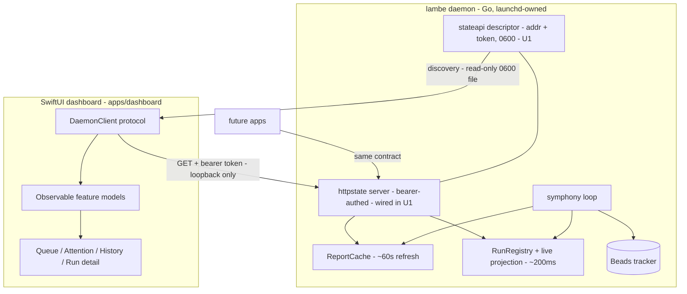
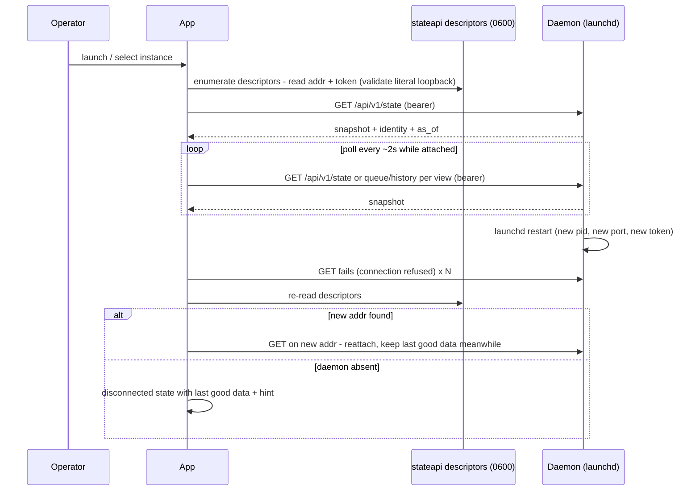
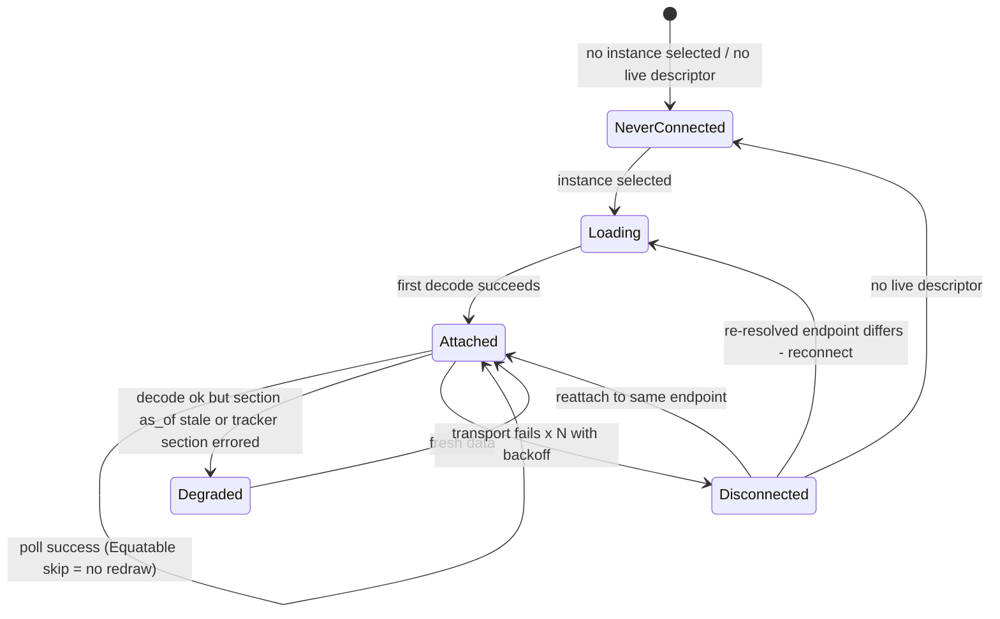

# lambe SwiftUI operator dashboard - Plan

## Goal Capsule

- **Objective:** An operator on the machine where lambe runs opens a native macOS app, sees the supervisor's actual state — what is queued, what needs a human, what has finished, and what any run is doing right now — without a terminal, and future client apps can adopt the same documented local contract instead of inventing their own channels.
- **Means:** A presentation-only SwiftUI app (`apps/dashboard/`) polling the daemon's loopback HTTP state API, plus the Go-side work that makes that API real: wiring the existing-but-dead `internal/httpstate` server into the daemon behind an explicit-opt-in bearer-auth middleware, extending it to carry the four views' data, publishing per-instance endpoint discovery, and documenting the versioned contract (KTD1, KTD3).
- **Authority hierarchy:** User direction (this run's brief) > Symphony SPEC @ `8001b52` (§13.7 route paths and shapes are pinned) > repo conventions (`AGENTS.md`, `docs/OPERATIONS.md`, single-writer sync model, viewer posture) > this plan's KTDs > unit approaches.
- **Execution profile:** Two workstreams in one repo — Go contract work first (U1–U5), Swift app second (U6–U8), release docs last (U9). Multiple PR-sized commits, gitmoji convention.
- **Stop conditions:** Stop and report if serving the extended contract proves incompatible with the pinned §13.7 shapes, or if a session-settled decision is invalidated by implementation evidence. Otherwise stop when the Definition of Done holds.
- **Who finishes:** `ce-work` implements; the owner reviews and ships. Swift builds run locally in Xcode on the owner's Mac; CI stays Go-only this slice (KTD9).

---

## Product Contract

### Summary

lambe's operator today reads state through `lambe status`, the TUI, and `bd`. This plan adds a native macOS SwiftUI dashboard that attaches to the same daemon over a documented, versioned loopback HTTP contract and renders Queue, Attention, History, and run details read-only. The Go side owns all state and the contract; the Swift side owns presentation only. The contract work (wiring, extension, discovery, documentation, fixtures) is deliberately built so future apps adopt it directly.

### Problem Frame

lambe's entire state lives in Beads and the daemon's in-memory projections, and the operator's read paths are all terminal: `lambe status`, the Bubble Tea TUI, `bd`, and structured logs. That is deliberate for a supervisor, but it means checking "what needs me?" requires a terminal and the right commands. The repo's own architecture doc named HTTP as "Symphony's optional /api/v1/state shape for dashboards", and `internal/httpstate` implements it — routes, DTOs, version stamp, loopback listener — but nothing ever starts the server: it is dead code, the exact "unit-green seam shipped dead" class the repo documented in `docs/solutions/best-practices/unit-green-seams-shipped-dead.md`. Meanwhile the live snapshot file crosses process boundaries but carries Go-cased names, no schema version, and no queue data — unusable as a versioned contract for future apps. The gap: a real, served, documented local contract plus one native client that proves it. (The former architecture non-goal "No UI beyond the HTTP state surface" is superseded by this plan; revising that doc is in scope, R20.)

### Requirements

**Read parity over the local contract**

- R1. The dashboard renders Queue, Attention, History, and run details from the daemon's HTTP state API alone: it reads no tracker, no live snapshot file, and shells out to nothing.
- R2. Queue shows readiness rows for every configured label — ready and blocked tasks with reason and blocker IDs — matching the TUI's Queue semantics.
- R3. Attention shows needs-human items with their real reason (authoritative tracker metadata, never a hardcoded placeholder), how long each has waited, and recent gate rejections sourced from the existing `LastGate`/status records — kind and time included only when actually known, explicitly unknown otherwise (no fictional exact kind/timestamp).
- R4. History shows completed and failed runs — terminal live rows plus attempts archived as interrupted on restart — bounded at 100 entries, newest-first, preserved across daemon restarts.
- R5. Run detail shows phase, attempt, turn, thread, workspace path, workflow, wake-at, last gate output preview, and output tail for the selected run, at parity with what the TUI's inspector shows.

**Contract and daemon wiring**

- R6. The daemon serves the HTTP state API on loopback only when explicitly enabled — `stateapi.enable` defaults **false** (opt-in); the three §13.7 routes (`GET /api/v1/state`, `GET /api/v1/{issue}`, `POST /api/v1/refresh`) keep their paths and shapes, and every production listener route — including the refresh POST — requires a per-start random bearer token enforced by a single auth middleware: constant-time comparison, no unauthenticated bypass, strict Host check, no permissive CORS headers. Existing handler logic and DTOs are preserved unchanged for authenticated requests; all other reads extend `/api/v1/` compatibly.
- R7. The bound endpoint and its token are discoverable without any client re-implementing Go logic: after acquiring the instance lock, the enabled daemon atomically writes a per-instance 0600 endpoint descriptor (addr, bearer token, pid, identity, version, started-at) into the existing 0700 live dir and removes it on shutdown before releasing the lock; clients enumerate those descriptors — never rebuild any lock-name hash — and skip stale entries. `stateapi.enable` / `stateapi.addr` config keys (≤2 levels, env-reachable per the flattening rule) control the surface; `stateapi.addr` defaults `127.0.0.1:0` (ephemeral loopback); binding is loopback-only and a bind failure logs and continues — a viewer surface never kills the daemon.
- R8. The contract is documented for future apps — routes, DTO field semantics, per-section freshness, evolution and version-mismatch policy, descriptor discovery, auth/read-only posture, history bounds and ordering, error envelopes — and pinned by Go-generated fixture files that the Swift tests decode.
- R9. Every response carries daemon identity (pid, identity, machine, version, config path) and per-section `as_of` RFC3339 timestamps; machine-readable RFC3339 timestamps accompany every human-rendered age string.
- R10. Served values are truthful: needs-human reason and wait time come from authoritative records where available (tracker metadata written on every needs-human path; times set wherever they exist); recent gate rejections are sourced from the existing `LastGate`/status records, carrying gate kind and time only when actually known and marked unknown otherwise — no separate new gate-rejection persistence is added if existing records satisfy read parity.

**Client behavior**

- R11. The connection lifecycle is explicit UI state — never-connected, loading, attached, degraded (stale `as_of` shown, never silently mixed), disconnected (keeps last good data, re-resolves the endpoint with backoff before declaring the daemon down).
- R12. Version skew degrades visibly: unknown enum values decode to neutral placeholders, unknown fields are ignored, and a higher-than-expected `schema_version` shows a "daemon newer than app" banner instead of failing to decode.
- R13. The app is strictly read-only and GET-only: no mutation controls, no POST calls — `POST /api/v1/refresh` triggers a full supervisor cycle and can write to the hub, so the app must never call it — no daemon start/stop or process ownership of any kind, no tracker access; views explain why actions are absent ("read-only — resolve in bd / the tracker"). This is required by the single-writer sync model and launchd ownership, not merely preferred.
- R14. Instance selection is explicit in Settings — an ordered list the operator maintains, each entry resolved to exactly one running daemon — so a dev-smoke instance is never confused with production; the window shows which daemon (identity and version) it is attached to.
- R15. Polling runs at a few seconds while attached with exponential backoff capped near 15 s while disconnected; request timeouts fail fast (no `waitsForConnectivity`); descriptor reads use the same bounded timeouts with a small retry; cancellation stops retries immediately. Before sending the token the client validates the descriptor's addr is literally `127.0.0.1`; it never follows redirects and never logs or embeds the token in errors.

**Repo, tooling, docs**

- R16. The app lives in `apps/dashboard/` with a committed Xcode project that opens and builds on a fresh checkout or worktree with no generation step; Go packages and `go.mod` are untouched; Xcode build outputs are git-ignored.
- R17. Xcode launch (open the project, Cmd+R) and CLI build/test paths (`xcodebuild … -destination 'platform=macOS'`) are documented in the repo; the v1 test bar is Swift Testing decode and model tests — zero UI tests.
- R18. Dashboard dev smokes run against disposable trackers and state dirs and never touch the production daemon, the launchd service, or existing workflows (the existing `.dev/real-hub-smoke.sh` remains as-is).
- R19. mise gains dashboard build/test/smoke tasks; no JavaScript tooling is introduced — Turborepo was evaluated and rejected (KTD8).
- R20. Repo docs stay truthful: the `docs/ARCHITECTURE.md` non-goal line is revised, README's HTTP-state-API claim reflects the now-wired reality, and `CHANGELOG.md` carries `[Unreleased]` bullets per its convention.

### Key Decisions

- **Go owns supervisor and persistence; the SwiftUI app handles presentation only.** (session-settled: user-directed — chosen over embedding the Go engine in the Swift app or duplicating engine logic in Swift: one engine of truth, no drift.) Governs R1, R13.
- **Dashboard and engine ship in the same repository.** (session-settled: user-directed — chosen over a split app repo: contract and client evolve atomically.) Governs R16.
- **Commit convention stays gitmoji + imperative summary.** (session-settled: user-directed — chosen over plain conventional-commit subjects: repo convention consistency per `CONTRIBUTING.md`.)
- **First release is a minimal native end-to-end path** — launch, attach, browse the four views — with broader surface following later. (session-settled: user-directed — chosen over building the full dashboard surface first.) Governs R1, R16, R17.
- **The HTTP state API is the local contract for the dashboard and all future apps.** Chosen during planning over per-app channels (live-file scraping, a socket protocol): the contract already exists in code, is §13.7-shaped, and a versioned HTTP surface is the only channel that serves the documented-contract ambition without duplicating Go behavior in every client. Governs R6, R8.

### Success Criteria

- The four views show data an operator can act on: queue rows with reasons, attention items with real reason and age, history that survives a daemon restart, run detail matching the TUI inspector's facts.
- The API is private by default: nothing listens unless `stateapi.enable` is set, and when enabled every route — including refresh — refuses unauthenticated calls while the app still renders all four views with real data.
- The operator can select a smoke instance in the app and can always tell which daemon they are looking at (identity/version in the window).
- A future app author can implement a working client from `docs/api/state-api.md` plus the committed fixtures alone, with no lambe source access.
- Existing workflows are untouched: the fault suite, `real-hub-smoke.sh`, launchd ownership, and §13.7 conformance all hold.

### Scope Boundaries

Outside this product's identity (non-goals): any mutation surface in v1 (resolve, retry, start/stop, spawn — the TUI's task-creation is explicitly not a pattern to copy); remote/non-loopback access; multi-user or network-hardened auth (the per-start bearer token hardens the local single-user surface; it is not a network boundary); replacing the CLI/TUI; iOS/iPadOS or non-macOS clients; live log streaming in the app.

Deferred to Follow-Up Work: macOS CI runner job (path-filtered) once the app stabilizes; notarized/Developer-ID distribution; `MenuBarExtra` menu-bar presence; `lambe endpoint [-config FILE]` convenience subcommand over the descriptors; migrating the TUI's readiness reads onto `internal/stateapi`; UDS transport if the app ever sandboxes; the license change — deliberately out of scope until an explicit license choice is made (LICENSE is MIT today and NOTICE already carries the Symphony Apache-2.0 attribution; the in-repo Swift app needs no license work).

---

## Planning Contract

### Key Technical Decisions

- KTD1. **Transport is loopback HTTP over the existing `internal/httpstate` server — wire it, don't build a new channel; the Swift client is HTTP-only.** The live snapshot file stays a Go-client surface (README-blessed for scripts), never read by the app — reading it would duplicate `ReadLive`'s identity/liveness/bound semantics in Swift, the duplication the settled presentation-only decision forbids. Chosen over Unix domain sockets: UDS only pays off under App Sandbox (sandboxed apps connect only within container/app-group paths, with a ~104-byte `sun_path` limit), and v1 ships non-sandboxed where loopback HTTP needs no ATS exception, no entitlement, and triggers no local-network privacy prompt (verified against current SDKs, 2026-11). Bake-off note: the transport alternatives were concrete enough to compare directly on this evidence, so no bake-off ran; reversal is cheap now and expensive only after clients adopt the contract, which is why the contract doc (U3) lands first among user-facing pieces.
- KTD2. **Contract evolution: `schema_version` stays 1; evolution is additive-only.** New fields are optional (`omitempty`), unknown enums get client-side neutral fallbacks, and a version bump happens only on a breaking change. Correcting wrong field *values* (hardcoded reason/gate, unset times) is not a shape break, and no production consumer exists today (the seam was dead), so no bump is warranted. The field-name stability test extends additively; Go-generated fixtures pin the extended shapes (R8).
- KTD3. **`stateapi` defaults, auth, and discovery.** `stateapi.enable` defaults **false** — the local API is an explicit opt-in (an unauthenticated-or-unknown listener must not appear on production daemons by default; opt-in leaves the existing posture untouched until the operator asks). `stateapi.addr` defaults `127.0.0.1:0` (ephemeral loopback); config validation rejects non-loopback binds (all errors collected in one pass, per repo convention). When enabled, the daemon generates a per-start random bearer token (`crypto/rand`) and one auth middleware wraps every route — including the refresh POST: constant-time token comparison (`crypto/subtle`), a uniform 401 error envelope for missing and wrong tokens on every route (no unauthenticated bypass, no route-specific exceptions), a strict Host check against the bound loopback host, and no permissive CORS headers anywhere. Handler logic and DTOs are untouched behind the middleware — §13.7 shapes hold for authenticated requests. Discovery: on successful bind — after the instance lock is held — the daemon atomically writes a per-instance descriptor `<stateDir>/live/stateapi-<instance>.json` (0600 in the existing 0700 dir) carrying instance name, config path, addr, the bearer token, pid, identity, version, started-at, and removes it on shutdown **before releasing the instance lock**. Chosen over the earlier draft's default-on + unauthenticated reads (insecure) and its single merged `endpoints.json` with best-effort concurrent upserts (a racy shared file), and over hash-named descriptor files (clients would have to reproduce `InstanceLockName`'s tracker-path hash — violating the presentation-only decision). Clients enumerate `stateapi-*.json` descriptors instead and skip stale entries (pid/identity mismatch); clients never delete descriptors — the owning daemon does.
- KTD4. **Vocabulary: keep the coarse machine `state` enum, add the operator `phase` alongside it.** The §13.7/MCP-aligned run states (`pending|running|deferred|settled|failed|canceled`) stay stable for machines; the richer live-projection phase strings (`running`, `gating`, `retry`, `stopped: gate green`, `interrupted`, …) ship as additive fields for display, with the mapping documented in the contract. Chosen over redesigning one vocabulary (would break §13.7 shapes and MCP parity) and over mapping in Swift (duplicates Go semantics).
- KTD5. **Shared-client seam in Go: `internal/stateapi`.** A small typed client (resolve by enumerating the descriptors, typed calls over the shared DTOs) exists from this slice and its first consumers are the assembled-path smoke tests (U5) — a seam with a test-only consumer is exactly the dead-seam shape, so the smoke drives it through the real binary. The client hardening is non-negotiable and shared with the Swift client: literal-`127.0.0.1` validation before the token is attached, redirects refused, bounded timeouts with a small retry, and the token never logged or embedded in error values; reads are cached outside the call path with a short TTL so repeated smoke assertions don't multiply tracker reads. Migrating the TUI's readiness reads onto it is deferred (the TUI must keep working when `stateapi` is disabled).
- KTD6. **Swift project: committed `.xcodeproj` using Xcode 16+ file-synchronized groups; `SWIFT_VERSION = 6.0` with MainActor-default isolation and approachable concurrency; deployment target macOS 26.0; App Sandbox off; ad-hoc signing ("Sign to Run Locally"); no ATS keys, no entitlements.** XcodeGen was evaluated and rejected for v1: the generate-before-build step is silent-staleness-prone ("build succeeds" without newly added files), adds a brew dependency to a Go-first repo, and adds worktree friction; Tuist is overkill for one target; a SwiftPM executable cannot produce a real `.app`. Revisit generators only if targets multiply. macOS 26.0 matches current templates and the owner's fleet; the zero-gymnastics API floor for everything used here is macOS 14 (`@Observable` is the binding constraint) if an older Mac ever must run it. Sandbox off is safe because App Sandbox is a Mac App Store requirement, and keeping it off preserves the deferred UDS option.
- KTD7. **Swift architecture: `@Observable` `@MainActor` feature models + protocol-seamed client; Swift Testing; no UI tests in v1.** One observable model per feature area (Queue, Attention, History, run detail) owned by its root view, an app-level daemon-connection model injected via `.environment`, the API client behind a `DaemonClient` protocol (stubbed in tests), `Equatable` model payloads so identical poll responses cost zero re-renders, poll loop inside `.task` with backoff and endpoint re-resolution on repeated failure, `ContentUnavailableView` for empty/error states. No MVVM framework, no TCA — nothing here justifies one.
- KTD8. **Orchestration: mise tasks, not Turborepo.** The brief flagged this open; evaluation: Turborepo requires root `package.json`/workspace plumbing and has no language graph intelligence outside JS/TS — it would be this repo's first JavaScript with nothing JavaScript-shaped to orchestrate. mise already pins the toolchains and supports monorepo tasks; add `dashboard:build` / `dashboard:test` / `smoke:dashboard` task wrappers around `xcodebuild` and the smoke test.
- KTD9. **Distribution and CI: local Xcode builds only in this slice; no macOS CI runner.** GitHub runners are ubuntu-only today; a macOS runner costs ~10× minutes and Actions minutes are a hard budget (deploy capacity). goreleaser stays single-Go-binary untouched. Caveat carried into smoke docs: darwin Go binaries must be built on macOS or ad-hoc re-signed (`codesign -s -`) — macOS 26/27 SIGKILL unsigned or degenerate linker-signed binaries, so the smoke never downloads a cross-compiled release artifact.

### Assumptions

- Deployment target macOS 26.0 matches the operator's machines; lower to 14.0 if an Intel-era Mac must run the app.
- The owner's Mac has Xcode 26/27 installed; the app is not distributed beyond local builds in this slice.
- Explicit opt-in (`stateapi.enable` default false) means production daemons run unchanged until the operator enables the API; dev configs and the smoke enable it, and every enabled route is bearer-guarded.
- ~60 s worst-case tracker-section staleness with a visible `as_of` is acceptable operator UX in v1, since the app makes no refresh POSTs (R13).
- The primary needs-human path gains the reason metadata write in this slice (U2), so the contract's truthful-reason guarantee holds; today only the blocked-fallback path writes it.
- Toolchain facts (Xcode 27.2 / Swift 6.4 current, macOS 27 stable) are as of the 2026-11-19 research; verify at implementation start.

### Risks & Dependencies

| Risk | Decision |
|---|---|
| Wiring `httpstate` without a through-the-wiring test repeats the repo's documented P1 dead-seam class | U1 lands the assembled-path test first, per `docs/solutions/best-practices/unit-green-seams-shipped-dead.md`; the smoke (U5) re-proves it at binary level |
| launchd `KeepAlive` restarts the daemon → new pid, new ephemeral port, new per-start token while the app is open | Descriptor re-read on repeated connection failure (R11) covers addr and token together; identity in every response (R9) |
| `POST /api/v1/refresh` is mutating — it triggers a full supervisor cycle and can write to the hub — on an authenticated local route | The app is GET-only (R13); the contract doc marks refresh as an operator action; any future client POST use requires the `examples/services/APPROVAL_POSTURE.md` human-decision bar — out of scope here |
| Two vocabularies (state vs phase) drift apart | KTD4 documents the mapping in the contract; fixtures pin both |
| README/docs drift (config table already drifted from `internal/config`) | New keys follow `internal/config/config.go` as source of truth; docs updates land in U3/U9, not in README first |
| Swift toolchain churn (Xcode betas, MenuBarExtra regressions in 27.x) | Plain `WindowGroup` dashboard, no beta APIs, deployment target 26.0 stable line |
| Actions-minutes budget | No macOS CI this slice (KTD9); deferred job is path-filtered when added |

### High-Level Technical Design

Component topology — the surfaces pattern gains a fifth, external surface; all state stays in the daemon:



Attach and reattach — discovery precedes every attach; repeated transport failure re-resolves before declaring the daemon down:



Connection lifecycle in the app — one state machine shared by all views; per-view emptiness is orthogonal:



### Output Structure

New layout (Go packages unchanged in placement; new app and contract homes):

```text
apps/dashboard/                     Swift app (R16)
  LambeDash.xcodeproj               committed, synchronized groups
  README.md                         Xcode launch + CLI build/test paths
  Sources/
    LambeDashApp.swift              @main, WindowGroup + Settings
    Api/                            DaemonClient protocol, HTTP client, DTOs, decoding
    Models/                         connection model + feature models
    Views/                          shell, four views, settings/instance picker
  Tests/
    ApiTests/                        fixture decode + skew + state-transition tests
    Fixtures/                        Go-generated contract fixtures (committed)
internal/stateapi/                  Go client seam (KTD5)
  client.go
  client_test.go
docs/api/state-api.md               the versioned local contract (R8)
docs/plans/                         this plan
```

Modified: `internal/daemon/{lifecycle,wire,state,status}.go`, `internal/httpstate/{server,auth,dto}.go` + tests, `internal/gate/writeback.go`, `internal/config/config.go` + tests, `README.md`, `docs/ARCHITECTURE.md`, `CHANGELOG.md`, `mise.toml`, `.gitignore`.

### Sequencing

Phase A (Go contract): U1 wires and discovers; U2 makes the data truthful and view-complete; U3 documents and pins with fixtures; U4 adds the Go client; U5 proves the whole assembled path safely. Phase B (Swift): U6 scaffold, U7 data layer, U8 views. Phase C: U9 release docs and checklist. U6 may start once U3's fixtures exist; U7–U8 depend on U2's shapes being final.

---

## Implementation Units

### U1. Wire the HTTP state surface into the daemon

- **Goal:** The daemon actually serves `/api/v1` on loopback when explicitly enabled, bearer-guarded on every route, with per-instance endpoint discovery — the dead seam becomes real without becoming an unguarded surface.
- **Requirements:** R6, R7, R9 (identity sources), R10 (partial: descriptor truth); implements KTD3.
- **Dependencies:** none.
- **Files:** `internal/config/config.go` + `config_test.go`, `internal/daemon/lifecycle.go`, `internal/daemon/wire.go`, `internal/httpstate/server.go` (addr parsing alongside `ListenLoopback`), `internal/httpstate/auth.go` + `auth_test.go` (middleware), `internal/daemon/state.go` (descriptor writer), `cmd/lambe` tests, `internal/httpstate/server_test.go`.
- **Approach:** Add `stateapi.enable` (default **false** — explicit opt-in) and `stateapi.addr` (default `127.0.0.1:0`) through the koanf stack — defaults, `Config` struct, `validate` (reject non-loopback, collect all errors), `Summary()`. In `Run()`, after the instance lock is held and trackers open: if enabled, generate a per-start random bearer token (`crypto/rand`), bind (ephemeral unless addr set), wrap the mux in one auth middleware (`internal/httpstate/auth.go`) — constant-time token comparison (`crypto/subtle`), a uniform 401 envelope for missing and wrong tokens on **every** route including the refresh POST, strict Host check against the bound loopback host, no CORS headers on any response — then construct `httpstate.New(d.StateSource(), ln)` unchanged behind it, serve in a goroutine, shut down in `d.shutdown`; a bind failure logs and continues (viewer-surface doctrine). Existing handler logic and DTOs are untouched: auth wraps, never rewires (§13.7 shapes hold for authenticated requests). On successful bind, atomically write the per-instance descriptor `<stateDir>/live/stateapi-<instance>.json` (temp-file + rename, 0600 — addr, token, instance, config path, pid, identity, version, started-at) and remove it in `d.shutdown` **before the instance lock is released**. Surface the bound addr in the startup Summary — never the token. Assembled-path coverage per the repo learning: a test that constructs the daemon the way `run` does (`daemon.New` + `DefaultWire`) — and one that invokes the built binary — proving an authenticated `/api/v1/state` answers and the descriptor exists.
- **Execution note:** Write the assembled-path test first; the wiring unit's tests must drive the assembled path, not re-fixture the seam (the learning's own words).
- **Patterns to follow:** `internal/daemon/lifecycle.go` single-defaults-site assembly; `internal/daemon/live.go` atomic file write; `internal/config/config_test.go` precedence tables; `var _ httpstate.StateSource = (*StateSourceAdapter)(nil)` compile-time seam check.
- **Test scenarios:**
  - Default config starts no listener; the daemon runs normally (`stateapi.enable` default false).
  - `stateapi.enable: true` serves `/api/v1/state` on an ephemeral loopback port; with the descriptor's token, `GET` returns `schema_version` 1.
  - Every route — state, `{issue}`, refresh, queue, history — returns the same 401 envelope without a token and with a wrong token; only the per-start token passes (no unauthenticated bypass, no route exception).
  - The middleware compares tokens with `crypto/subtle` constant time; missing-token and wrong-token responses are indistinguishable in shape (code-reviewed; no timing test).
  - A Host header other than the bound loopback host is rejected before any handler; no `Access-Control-*` header appears on any response, including 401 and OPTIONS.
  - The bearer token never appears in daemon logs, the Summary, or error strings.
  - `LAMBE_STATEAPI_ADDR=127.0.0.1:0` overrides the file value (env flattening, precedence table).
  - Non-loopback `stateapi.addr` is rejected in validation with every other error collected in the same pass.
  - Bind failure (addr already taken by a non-daemon process): logged, daemon continues, no descriptor written.
  - Descriptor written only after the lock is acquired, mode 0600, carrying addr + token + identity facts; removed on graceful shutdown before the instance lock is released; never written when disabled.
  - Two daemons with disjoint tracker paths under one state dir produce two distinct descriptor files (enumeration, not a merged document).
  - Assembled path: built binary with a disposable tracker answers an authenticated GET, and the descriptor is present — the dead-seam regression test.
- **Verification:** `go test -race ./internal/config/... ./internal/daemon/... ./internal/httpstate/...` and the `cmd/lambe` tests green; the assembled-path test fails if wiring is removed; the auth scenarios fail if any route bypasses the middleware.

### U2. Make the served data truthful and view-complete

- **Goal:** The contract carries everything the four views need, with correct values — queue readiness, real attention reasons and ages, history across restarts, rich run detail, identity, machine timestamps.
- **Requirements:** R2, R3, R4, R5, R9, R10; implements KTD4.
- **Dependencies:** U1.
- **Files:** `internal/gate/writeback.go`, `internal/daemon/status.go` + `status_test.go`, `internal/daemon/state.go` (adapter), `internal/httpstate/dto.go` + `server.go` + `server_test.go`, `internal/tracker` (readiness exposure behind the source seam).
- **Approach:** Write `lambe_needs_human_reason` metadata on the primary needs-human path (mirroring the blocked-fallback path) and surface it with a real `since` in `NeedsHumanDTO` — authoritative records first, gate-output summary as fallback, never a hardcoded constant. Recent gate rejections come from the **existing** `LastGate`/status records: `GateRejectionDTO` fields for kind and time are optional — populated only when those records actually carry them, omitted (unknown) otherwise; no fictional exact kind/timestamp, and **no new gate-rejection persistence** (existing records satisfy parity; the draft's separate persistence is dropped). Add `GET /api/v1/queue` returning readiness rows (id, title, reason, blocked, blockers) for **all configured labels** by exposing the tracker readiness read behind the `StateSource` seam — served from the daemon's canonical readiness read cached outside the request path, so the status projection, the queue route, and TUI parity all reuse one canonical result instead of each re-reading the tracker. Add `GET /api/v1/history` merging the live projection's terminal rows with attempts archived on restart (interrupted), sorted newest-first, bounded ≤100 with documented bounds. Enrich `GET /api/v1/{issue}` with phase, turn, thread, workspace, workflow, wake-at, last gate preview, and bounded output tail from the registry/live projection. Add a `daemon` identity block and per-section `as_of` RFC3339 to the snapshot; add `last_event_at` (RFC3339) alongside the human `last_event_age` (kept for display parity). §13.7 route shapes unchanged; the field-name test extends additively.
- **Patterns to follow:** `internal/daemon/state.go` adapter + compile-time check; `internal/daemon/status_test.go` fixture helpers and read-count perf contracts; `internal/httpstate/server_test.go` field-name pinning and `httptest` shape tests; bounded-tail pattern from `internal/mcp` `outputResult`.
- **Test scenarios:**
  - Primary-path needs-human item surfaces its real reason (fixture tracker with metadata) and a set `since`; fallback path still works when metadata is absent (reason degrades to the gate-output summary, never a hardcoded constant).
  - Gate rejection carries kind/time only when present in the existing `LastGate`/status records; when absent, the fields are omitted (unknown) — never fabricated.
  - Queue route returns ready and blocked rows for every configured label, with reasons and blocker IDs; empty tracker yields an empty list, not an error; repeated queue and status calls within the cache window hit the tracker once (canonical-result reuse).
  - History route returns newest-first entries within the 100 bound, including terminal live rows and restart-archived attempts; a daemon restart archives in-flight runs as `interrupted` and they appear in history.
  - Run detail for a registry run includes phase, attempt, turn, thread, workspace, workflow, wake-at, gate preview, and a ≤4 KB tail; unknown issue returns the typed 404 envelope.
  - Snapshot carries the daemon block (pid, identity, machine, version, config path) and per-section `as_of`; `last_event_at` is RFC3339 wherever `last_event_age` appears.
  - Existing §13.7 field-name test passes unchanged; extended names are pinned additively.
- **Verification:** `go test -race ./internal/httpstate/... ./internal/daemon/... ./internal/gate/...` green.

### U3. Document the versioned local contract and pin it with fixtures

- **Goal:** Future apps can implement a client from the docs plus committed fixtures alone; the repo's public claims match reality.
- **Requirements:** R8, R9, R10 (documentation side), R20.
- **Dependencies:** U2.
- **Files:** `docs/api/state-api.md`, `internal/httpstate/contract_test.go` (fixture generator + error-shape and route-precedence tests), `testdata/contract/v1/*.json`, `README.md`, `docs/ARCHITECTURE.md`, `CHANGELOG.md`.
- **Approach:** The contract doc states: route table with methods and response DTOs; per-field semantics including explicit `omitempty` absent-vs-empty rules; the state/phase vocabulary mapping (KTD4); freshness per section with `as_of`; additive-only evolution, `schema_version` bump policy, and the higher-major client behavior; descriptor discovery spec (enumerate `live/stateapi-*.json`, never rebuild any hash, bounded reads with small retry, skip stale entries); auth posture (bearer token required on every route including refresh, read only from the 0600 descriptor; `POST /api/v1/refresh` is **mutating** — it triggers a full supervisor cycle and can write to the hub — so it is documented as an operator action, not an advisory; client guidance: validate literal `127.0.0.1` before sending the token, never follow redirects, never disclose the token in logs or errors); history bounds, ordering, and the terminal-plus-archived merge; error envelopes and codes including 401. A table-driven Go test marshals canonical `SnapshotResponse`, queue, history, issue, and `ErrorResponse` fixtures into `testdata/contract/v1/` behind an `-update` flag, and asserts committed fixtures decode into the current DTOs — drift fails CI. Pin error shapes (401/404/405/bad-request JSON) and route precedence (`/api/v1/state` exact vs `/{issue}` wildcard). README: correct the premature HTTP-state-API claim, document the now-real surface (opt-in, bearer-guarded) and the dashboard. ARCHITECTURE: revise the non-goal line to name the SwiftUI dashboard as the fifth surface. CHANGELOG: `[Unreleased]` bullets.
- **Test scenarios:**
  - Fixture generation is idempotent; committed fixtures decode into current DTO types.
  - Error envelopes for unauthenticated 401, catch-all 404, wrong-method 405, and bad request are pinned JSON, not plaintext.
  - `/api/v1/state` matches before `/{issue}` for the literal path.
  - README's state-API claim and ARCHITECTURE's surface list match the wired behavior (checked by review against the smoke, not by a test).
- **Verification:** `go test ./internal/httpstate/...` green including fixtures; docs reviewed against the running daemon during U5's smoke.

### U4. Go shared-client seam (`internal/stateapi`)

- **Goal:** A typed Go client over the documented contract exists for Go-side consumers and tests — the "shared client" is a real seam, not a slogan.
- **Requirements:** R7 (discovery consumer), R8 (contract consumer); implements KTD5.
- **Dependencies:** U1 (descriptors), U2 (shapes).
- **Files:** `internal/stateapi/client.go`, `internal/stateapi/client_test.go`.
- **Approach:** `Resolve` enumerates `<stateDir>/live/stateapi-*.json` (no lock-name hash math), selects by instance or config path, and drops entries whose pid fails the identity check or whose addr is not literally `127.0.0.1`; `Client` offers typed `State`, `Queue`, `History`, `Issue` calls over `net/http` with the descriptor's bearer token attached — only after the loopback validation, with redirects refused (`CheckRedirect` errors), bounded timeouts and a small retry, and the token never logged or embedded in error values. Calls reuse `internal/httpstate` DTO types (same module — no duplication) and cache the last response per route with a short TTL outside the call path. Small, documented, exported — its consumers are U5's smoke and future Go surfaces.
- **Test scenarios:**
  - Resolve returns the matching instance's addr and token from a fixture descriptor dir; a stale entry (pid identity mismatch) is skipped; a non-loopback addr is rejected before any token is attached.
  - Each typed call decodes its committed contract fixture and sends the bearer header.
  - A redirect response is refused, not followed; a slow server hits the bounded timeout and the small retry budget.
  - Transport and status errors map to typed errors distinguishable from decode errors; no typed error carries the token.
  - A second call within the TTL is served from cache (one transport hit).
- **Verification:** `go test -race ./internal/stateapi/...` green.

### U5. Dashboard dev smoke — assembled, production-safe

- **Goal:** An executable proof that the assembled real daemon (bearer-authed, descriptor-publishing) serves all four views — and that the real `.app` attaches to it — over isolated fixture state, with production, launchd, and existing workflows untouched.
- **Requirements:** R18; enforces R1–R7 end-to-end; implements KTD5's consumer.
- **Dependencies:** U1–U4.
- **Files:** `test/dashsmoke/` (Go smoke in the `test/faultsuite` style: builds the real binary, disposable tracker + config + `LAMBE_STATE_DIR`), `test/dashsmoke/README.md`, `.dev/dashboard-smoke.sh` (uncommitted, matching `.dev` practice) for the assembled daemon + app pass.
- **Approach:** The Go smoke seeds a fixture tracker (queue rows across all configured labels, a needs-human item with metadata, `LastGate` records, finished runs), boots the built `lambe` binary with its own state dir and `stateapi.enable: true`, enumerates the descriptor like any client, and drives `internal/stateapi` asserting all four views' payloads — including an unauthenticated request (no token, then a wrong token) being refused 401 on every route, and the descriptor being gone after shutdown. The harness owns every process; **the client owns none** — the app never spawns, kills, or waits on the daemon (asserted by construction: no process APIs anywhere in the app's Sources). The `.dev` script wraps the same isolation, then launches the **built `.app`** from `apps/dashboard` against the smoke instance for the assembled daemon + app pass (explicit instance selection; Dock-env caveat documented: a Dock-launched app does not inherit `LAMBE_STATE_DIR`, which is exactly why selection is explicit per R14). A smoke pass is complete only when the Go assertions and the app pass both succeed against the isolated fixture state. Cleanup trap restores everything; exit codes follow the existing smoke script's semantics.
- **Execution note:** Smoke-first verification is the point of this unit — prefer the running-binary assertions over any new unit fixtures.
- **Test scenarios:**
  - Smoke daemon serves queue, attention, history, and run detail with the seeded facts, asserted through the Go client against the real binary.
  - Unauthenticated access is refused: no token and a wrong token yield 401 on state, issue, queue, history, and refresh.
  - The smoke's state dir is disposable (temp under the test dir) and the production launchd service is never invoked (assert by construction: no `launchctl`/`bootout` in the Go smoke path).
  - The built `.app` attaches via descriptor enumeration and renders the seeded facts (assembled daemon + app pass, recorded).
  - The `.dev` script cleans its temp dir and exits non-zero when any assertion fails.
- **Verification:** `go test ./test/dashsmoke/` green (bd-gated where it needs a real tracker, consistent with `LAMBE_TEST_BD` convention); the assembled daemon + `.app` pass recorded in the PR.

### U6. Swift app scaffold (`apps/dashboard`)

- **Goal:** A committed Xcode project that opens and builds on a fresh checkout or worktree with no generation step; app and test targets exist with the toolchain decisions applied.
- **Requirements:** R16, R17; implements KTD6.
- **Dependencies:** none (may start in parallel with Phase A after U3 fixes fixture locations; no code dependency).
- **Files:** `apps/dashboard/LambeDash.xcodeproj` (synchronized groups), `apps/dashboard/Sources/LambeDashApp.swift` (minimal `@main`: `WindowGroup` + `Settings`), `apps/dashboard/Tests/AppSmokeTests.swift`, `apps/dashboard/README.md`, `.gitignore` (DerivedData, `.build`).
- **Approach:** One application target + one unit-test target; `SWIFT_VERSION = 6.0`, `SWIFT_DEFAULT_ACTOR_ISOLATION = MainActor`, `SWIFT_APPROACHABLE_CONCURRENCY = YES`; `MACOSX_DEPLOYMENT_TARGET = 26.0`; ad-hoc signing; no Info.plist ATS keys, no entitlements. The app struct renders a placeholder shell so Cmd+R shows a window on day one.
- **Test scenarios:**
  - One trivial Swift Testing test asserts the test target runs (the v1 UI-test bar is zero; this proves the harness works).
- **Verification:** `xcodebuild -project apps/dashboard/LambeDash.xcodeproj -scheme LambeDash -destination 'platform=macOS' build` and `… test` succeed from a clean checkout; opening the project in Xcode and pressing Cmd+R shows a window; `git status` clean after a fresh-clone build (no generated artifacts required).

### U7. Swift contract client and models (data layer)

- **Goal:** A typed, skew-tolerant client and `@Observable` models implementing the connection lifecycle — everything testable without launching UI.
- **Requirements:** R1 (client side), R9, R11, R12, R14 (model side), R15; implements KTD7.
- **Dependencies:** U2 (shapes), U3 (fixtures), U6.
- **Files:** `apps/dashboard/Sources/Api/` (DTOs, `DaemonClient` protocol, `HTTPDaemonClient`, descriptor decode, `APIError`), `apps/dashboard/Sources/Models/` (connection model + per-feature models), `apps/dashboard/Tests/ApiTests/`, `apps/dashboard/Tests/Fixtures/` (mirroring `testdata/contract/v1/`, committed).
- **Approach:** DTOs mirror the contract additively: optional fields with defaults via `decodeIfPresent`, every wire enum carrying a neutral unknown case, unknown keys ignored by the decoder. `APIError` distinguishes transport, status, and decoding failures. The connection model owns: instance list persisted locally, endpoint resolution by enumerating the descriptors, poll cadence (~2 s attached, exponential backoff capped ~15 s disconnected, fail-fast timeouts, cancellation-aware), endpoint re-resolution on repeated failure (re-read covers addr **and** token), identity-change detection (reattach), and per-section `as_of` exposure for the degraded state. Feature models hold `Equatable` payloads plus a phase enum (`loading/loaded/empty/disconnected`) derived from fetch outcomes; identical payloads skip invalidation. The HTTP client attaches the descriptor's bearer token only after validating the addr is literally `127.0.0.1`, refuses redirects, applies bounded timeouts with a small retry on descriptor reads, and never logs or embeds the token in `APIError` payloads.
- **Execution note:** Contract decode tests come first — every committed Go fixture decodes before any model logic exists.
- **Patterns to follow:** fixture loading relative to `#filePath`; Swift Testing parameterized cases; stub `DaemonClient` injection for model tests.
- **Test scenarios:**
  - Every committed fixture (state, queue, history, issue, error, descriptor) decodes; empty collections decode as empty.
  - An unknown enum value decodes to the neutral case; an extra unknown field is ignored; a missing optional field takes its default — one scenario each, parameterized across fixtures.
  - A higher-than-expected `schema_version` produces the newer-daemon banner state, not a decode failure.
  - Transport error (`cannotConnectToHost`) moves the model to disconnected while retaining last good items; recovery restores attached.
  - Repeated failures trigger endpoint re-resolution; a changed addr or token reconnects; no descriptor lands in never-connected.
  - A changed daemon identity between polls triggers reattach.
  - A redirect response is treated as an error, not followed; error payloads never contain the token.
  - Backoff escalates across failures and resets on success; cancellation stops the loop.
  - Identical consecutive payloads produce no change (Equatable short-circuit at the model boundary).
- **Verification:** `xcodebuild … test -destination 'platform=macOS'` green locally; all fixtures decode.

### U8. Dashboard views — the four views and shell

- **Goal:** The operator-visible dashboard: NavigationSplitView shell, Queue, Attention, History, run detail, truthful states, explicit read-only posture.
- **Requirements:** R1–R5 (rendering), R11, R13, R14 (window identity), R15 (indicators); implements the settled presentation-only decision via its R links.
- **Dependencies:** U7.
- **Files:** `apps/dashboard/Sources/Views/` (shell/sidebar, `QueueView`, `AttentionView`, `HistoryView`, `RunDetailView`, connection status footer, `SettingsView` instance picker).
- **Approach:** Two-column `NavigationSplitView` (sidebar sections; run detail as detail column), selection tracked by issue ID not index. Each view maps its model phase to: content list, `ContentUnavailableView` (empty — per-view copy), degraded banner with `as_of` ("tracker data as of …"), or disconnected banner keeping last good data dimmed with a retry. Attention's empty/action-less states carry the posture copy ("read-only — resolve in bd / the tracker"); no mutation controls exist anywhere; the daemon identity and version render in the window footer. Manual refresh (⌘R, GET only) and window-activation refresh hook the existing model paths.
- **Test scenarios:**
  - Phase-to-content mapping table test (attached/degraded/disconnected/empty per view → expected banner or list state) — pure logic, Swift Testing.
  - Selection survives a poll that reorders runs (selection by issue ID).
  - Attention empty state renders the posture copy; no view constructs a mutation control (compile-time absence asserted by review).
- **Verification:** Phase A + U7 tests green; visual pass against the dev daemon per U5's checklist; the mapping and selection tests green.

### U9. Docs, mise tasks, first end-to-end release checklist

- **Goal:** The launch/test story is documented where a contributor looks, orchestration is one command deep, and the minimal release has a nameable done state.
- **Requirements:** R17, R18 (doc), R19, R20; completes the release Definition of Done items.
- **Dependencies:** U5–U8.
- **Files:** `README.md` (dashboard section: Xcode open + Cmd+R, `xcodebuild` build/test, instance selection, dev-smoke pointer), `apps/dashboard/README.md`, `mise.toml` (`dashboard:build`, `dashboard:test`, `smoke:dashboard` tasks), `CHANGELOG.md`, `docs/OPERATIONS.md` (one paragraph: the dashboard as a read path; needs-human resolution still happens in the tracker).
- **Approach:** mise tasks wrap `xcodebuild` (with a repo-local derived-data path) and the smoke test. The release checklist, executed and recorded: app launches from Xcode → discovers the production instance via descriptor enumeration → renders all four views with correct data → survives a launchd restart of the daemon (reattach within the backoff budget, picking up the new token) → with the token withheld, every route refuses and the app shows disconnected rather than data → selecting the smoke instance shows smoke data without touching production → `go test ./...` (race where wired) and Swift tests green locally → docs truthful.
- **Test scenarios:** Test expectation: none — docs, task metadata, and checklist execution; the behavior it references is proven by U5 and the manual checklist.
- **Verification:** Checklist executed with results recorded in the PR; `mise dashboard:test` and `mise smoke:dashboard` run green from a clean shell.

---

## Verification Contract

| Check | Command / artifact | Gate |
|---|---|---|
| Go unit + integration tests | `LAMBE_TEST_BD=1 mise exec go -- go test -race ./...` | All green |
| Lint / format / vet / vulns | `go tool gofumpt -l .`, `go tool golangci-lint run ./...`, `go tool staticcheck ./...`, `go tool govulncheck ./...` | Clean |
| Contract fixtures | `go test ./internal/httpstate/ -run ContractFixtures` (and `-update` to regenerate) | Committed fixtures decode; drift fails |
| Auth + descriptor lifecycle | U1/U4 tests: uniform 401 on every route, strict Host, no CORS, token never logged; 0600 descriptor written after lock, removed before lock release | All green; no unauthenticated route exists |
| Dead-seam assembled path | `go test ./internal/httpstate/ ./cmd/lambe/` wiring tests; `go test ./test/dashsmoke/` | Server reachable through the real binary; four views served; unauthenticated calls refused |
| Swift tests (local) | `mise dashboard:test` → `xcodebuild test -scheme LambeDash -destination 'platform=macOS'` | All fixtures decode; model state tests green |
| Swift build (local) | `mise dashboard:build` → `xcodebuild build -scheme LambeDash -destination 'platform=macOS'` | Builds from clean checkout |
| §13.7 conformance | Existing `TestSnapshotFieldNames` + route-shape tests (run through the auth middleware with an injected test token) | Unchanged for the three pinned routes |
| Manual end-to-end | U9 checklist (launch, attach, four views, launchd-restart drill, withheld-token drill, smoke-instance selection) | All items pass |
| Docs truthfulness | README/ARCHITECTURE/CHANGELOG reviewed against the running daemon | Claims match behavior |

CI note: GitHub runners are ubuntu-only; Swift checks run locally this slice (KTD9). Go CI gates are unchanged and must stay green — the dashboard work adds no Go regression.

## Definition of Done

- All Verification Contract gates pass, including the assembled-path dead-seam tests, the auth and descriptor-lifecycle tests, and the binary-level dashboard smoke.
- The manual end-to-end checklist passes against the production daemon, including the launchd-restart reattach drill, the withheld-token refusal drill, and explicit smoke-instance selection with zero production interference.
- `stateapi` is explicit opt-in (default off), bearer-guarded on every route including refresh, and the descriptor lifecycle is clean: written after lock at 0600, removed before lock release — no stale files, no leaked tokens.
- The assembled daemon + `.app` smoke passes against isolated fixture state, with the client owning no processes.
- The four views show real data: queue rows with reasons, attention items with true reason and waiting time, history that survives a daemon restart, run detail matching the TUI's facts.
- `docs/api/state-api.md` plus committed fixtures suffice for a from-scratch client implementation — including the auth and discovery spec; §13.7 routes and field names hold.
- Every session-settled decision is implemented as labeled (KD1–KD4 above) or the run stopped with `settled-decision-invalidated`.
- Repo docs are truthful (ARCHITECTURE non-goal revised, README claim accurate, CHANGELOG bullets present); mise tasks exist; no JavaScript tooling was introduced.
- No dead experimental code: approaches tried and abandoned during implementation are removed from the diff, not left behind.

## Sources / Research

- `docs/solutions/best-practices/unit-green-seams-shipped-dead.md` — the dead-seam class `internal/httpstate` instantiates; mandates the assembled-path test shape (U1, U5).
- `/tmp/compound-engineering-501/ce-plan-research/5c35d302/repo-research.md` — routes/DTOs/versioning/`StateSource` trace, wiring points, lock/viewer posture, smoke isolation pattern, config flattening rule, CI/release facts.
- `/tmp/compound-engineering-501/ce-plan-research/5c35d302/spec-flow.md` — flow gaps C1–C4, I5–I11, M12–M17 absorbed into R6–R15, KTD2–KTD4, and the U2/U7/U8 approaches.
- `/tmp/compound-engineering-501/ce-plan-research/5c35d302/best-practices.md` — loopback ATS/privacy/sandbox findings, `@Observable` polling architecture, Swift Testing bar, monorepo layout, mise-vs-Turborepo evidence.
- `/tmp/compound-engineering-501/ce-plan-research/5c35d302/framework-docs.md` — macOS/Xcode/Swift versions, deployment-target floors, project-strategy comparison, launch/signing behavior, UDS sandbox constraints.
- `/tmp/compound-engineering-501/ce-plan-research/5c35d302/learnings.md` — institutional search (single relevant learning, cited above).
- `docs/ARCHITECTURE.md`, `docs/OPERATIONS.md`, `examples/services/APPROVAL_POSTURE.md`, `README.md`, `CONTRIBUTING.md` — surface pattern, single-writer sync model, viewer posture, conventions.
- `docs/plans/2026-11-15-1256-feat-lambe-slice-one-plan.md` — engine architecture, KTD/format precedent, and the deferred "HTTP /api/v1/state dashboard" roadmap entry this plan fulfills.
- Independent engineering review (2026-11-19) — explicit opt-in (default false) + per-start bearer auth on every route including refresh, strict Host / no CORS; per-instance 0600 descriptors replacing the racy merged manifest; queue caching outside the request with canonical projection reuse and merged terminal+archived history; `LastGate`-sourced gate rejections replacing new persistence; assembled daemon + `.app` smoke bar with no client process ownership. Applied throughout (R2–R4, R6–R7, R10, R13, R15, KTD3, KTD5, U1–U5, U7, U9).
